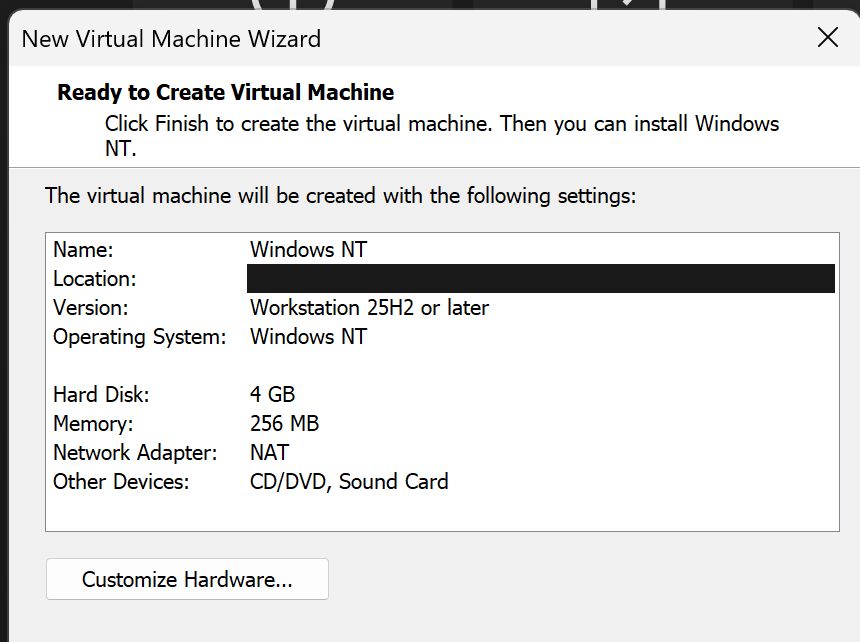
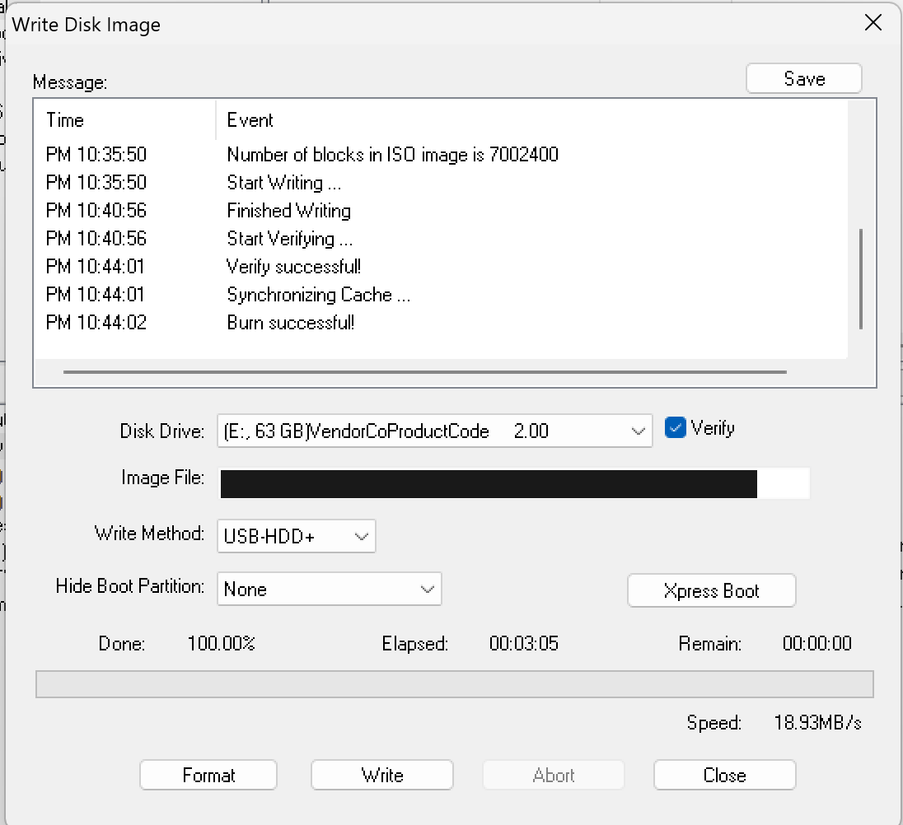

# Computer Systems and Networking Labs

Notes and screenshots from my computer systems and networking labs.

## Labs

- [Networking and DHCP](networking.md) — local networks, IP configuration and connectivity checks
- [Virtualization and LiveUSB](virtualization.md) — Windows NT VM setup, bootable USB and driver troubleshooting

## Tools

VMware Workstation, UltraISO, PuTTY, Windows Device Manager, `ipconfig` and `ping`.

## Screenshots

More screenshots and details are in the lab notes.
