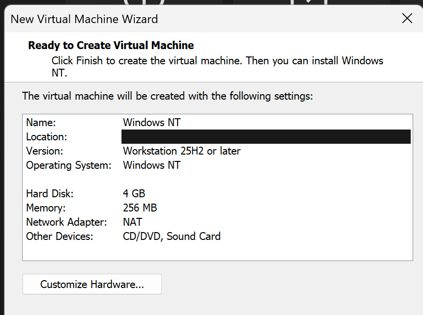
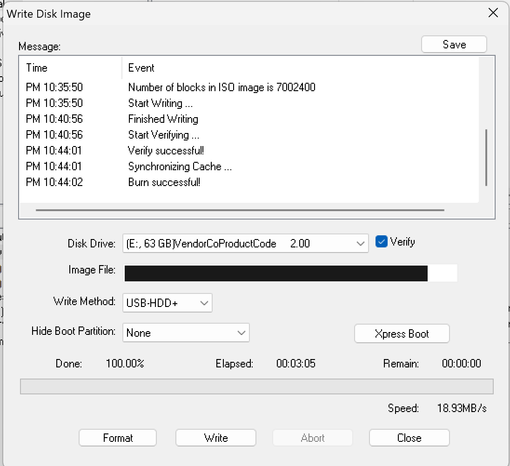

# Virtualization, LiveUSB and Windows troubleshooting

[Back to overview](README.md)

Practice 7 focused on virtual machines and bootable USB environments. The examples below document the Windows NT configuration and LiveUSB work from my lab session.

## 1. VMware Workstation

The VM configuration wizard used the following settings:

| Setting | Value |
| --- | --- |
| Guest OS | Windows NT |
| Virtual disk controller | SCSI |
| Virtual disk capacity | 4 GB |
| Memory | 256 MB |
| Network adapter | NAT |

The wizard indicated that NVMe was not supported by the selected Windows NT guest. SCSI was selected for the virtual disk.

*Virtual disk selection.*

*Configuration summary before VM creation. Local path masked.*

These screenshots document the VM setup, not a completed guest OS installation. Legacy Windows should be kept in an isolated or otherwise controlled lab environment.

## 2. LiveUSB

I used UltraISO to write the course LiveUSB image to a USB drive. The write method was USB-HDD+, with verification enabled. The application reported both successful verification and successful writing.

*Write and verification log at 100%. Local image path masked.*

The USB was then used for the boot exercise, as reported during the lab. The screenshot confirms media creation, not the subsequent boot. Writing a disk image can overwrite existing USB contents; the target drive must be checked before writing.

## 3. Touchpad troubleshooting

**Problem:** The laptop touchpad did not work during the LiveUSB exercise.

**Investigation:** I inspected the Windows HID over I2C device and Intel Serial IO GPIO host controller in Device Manager, including their driver files, providers and versions.

*HID over I2C driver details, including `hidi2c.sys` and `mshidkmdf.sys`.*

*Intel Serial IO GPIO host controller driver details.*

**Reported resolution:** Using the appropriate Lenovo driver and re-enumerating the device restored touchpad functionality. The retained screenshots show the diagnostic investigation; no separate post-fix screenshot is available.

**Takeaway:** Driver compatibility and the underlying controller can matter when troubleshooting an input device, particularly in a temporary operating-system environment.
