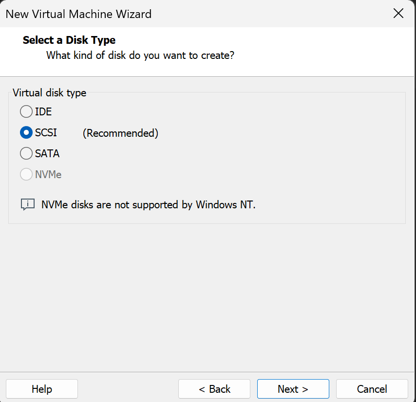
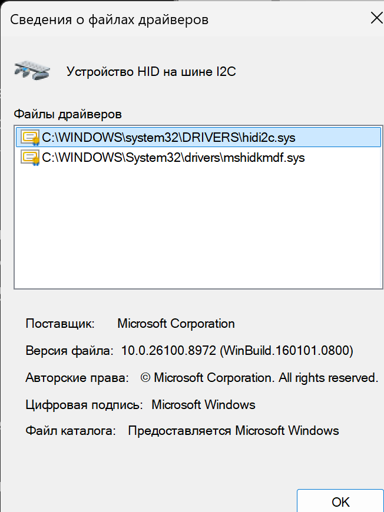
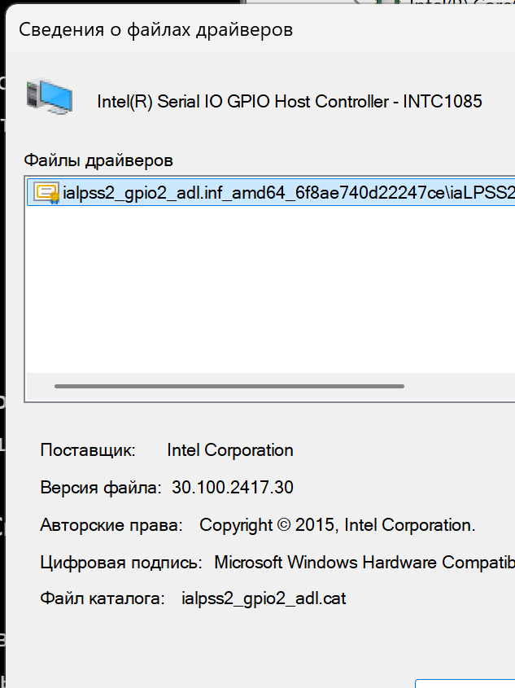

# Virtualization, LiveUSB and troubleshooting

[Back to overview](README.md)

## VMware Workstation

For practice 7, I configured a virtual machine for Windows NT.

| Setting | Value |
| --- | --- |
| Guest OS | Windows NT |
| Disk controller | SCSI |
| Disk size | 4 GB |
| RAM | 256 MB |
| Network | NAT |

NVMe was not supported for this guest, so I selected SCSI.

The screenshots show the configuration before VM creation, not the completed OS installation.

## LiveUSB

I used UltraISO to write the course image to a USB drive using USB-HDD+ with verification enabled. The writing and verification completed successfully, and I used the drive for the boot exercise.

The screenshot shows USB creation. Local paths in the screenshots are masked.

## Touchpad troubleshooting

The laptop touchpad did not work during the LiveUSB exercise. I checked the HID over I2C device and Intel Serial IO GPIO controller in Device Manager.

The touchpad worked again after using the appropriate Lenovo driver and re-enumerating the device. I kept screenshots of the driver checks, but not of the final result.
